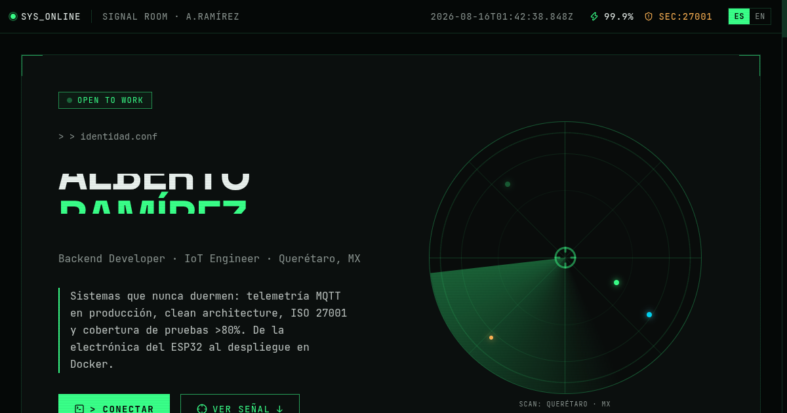

# SIGNAL ROOM — Portfolio de Alberto Ramírez

[](https://vitejs.dev)
[](https://react.dev)
[](https://www.typescriptlang.org)
[](https://tailwindcss.com)
[](https://nestjs.com)
[](https://mqtt.org)
[](https://www.iso.org/standard/27001)

> Portfolio personal con estética de **centro de control de telemetría IoT**:
> radar, osciloscopio, mapa de señal de proyectos y terminal de contacto.
> Personal portfolio with an **IoT telemetry control room** aesthetic.

**Live site:** [mario-ramirez.dev](https://mario-ramirez.dev) · **Perfil:** [github.com/rmMarioAlberto](https://github.com/rmMarioAlberto)



---

## ES — Acerca de

Soy **Alberto Ramírez**, Backend Developer e IoT Engineer de Querétaro, México. Este sitio es mi
SIGNAL ROOM: cada sección es un instrumento de un centro de control.

- **Hero / radar** — identidad y estado (OPEN TO WORK)
- **Telemetría** — métricas reales: 50+ dispositivos IoT, >80% coverage, 243+ tests, ISO 27001, GPA 9.54
- **Stack** — panel de instrumentos con 7 categorías
- **Mapa de señal** — 10 proyectos reales como nodos de red (IMOX Cloud flagship)
- **Trayectoria** — línea de tiempo ECG: Fitness Gym, Yex Acoustics (Imox Cloud), Atlas Copco
- **Logros** — Fraunhofer IIS (MIOTY), NASA Space Apps, Fin 4 All, IEEE UTEQ
- **Contacto** — terminal con typing animation

**Switch de idioma:** el header alterna ES/EN; se persiste en `localStorage` y actualiza
`lang`, `title` y meta description/OG dinámicos.

## EN — About

I'm **Alberto Ramírez**, a Backend Developer and IoT Engineer from Querétaro, Mexico. This site is
my SIGNAL ROOM: every section is an instrument in a control center.

- **Hero / radar** — identity and status (OPEN TO WORK)
- **Telemetry** — real metrics: 50+ IoT devices, >80% coverage, 243+ tests, ISO 27001, GPA 9.54
- **Stack** — 7-category instrument panel
- **Signal map** — 10 real projects as network nodes (IMOX Cloud flagship)
- **Track record** — ECG timeline: Fitness Gym, Yex Acoustics (Imox Cloud), Atlas Copco
- **Achievements** — Fraunhofer IIS (MIOTY), NASA Space Apps, Fin 4 All, IEEE UTEQ
- **Contact** — terminal with typing animation

**Language switch:** the header toggles ES/EN; persisted in `localStorage` and updates
`lang`, `title` and dynamic meta description/OG.

---

## Stack

| Capa | Tecnologías |
|---|---|
| Frontend | React 19, Vite 8, TypeScript, Tailwind CSS v4, lucide-react |
| Backend (perfil) | NestJS, Node.js, Spring Boot, FastAPI |
| IoT (perfil) | MQTT, ESP32, LoRaWAN, MIOTY, Arduino |
| DevOps (perfil) | Docker, GitHub Actions, SonarQube, OWASP ZAP |

## Correr localmente / Run locally

```bash
mise install          # node 22 + pnpm (mise)
pnpm install
pnpm dev              # http://localhost:8443
pnpm build            # typecheck + build de producción
pnpm preview          # sirve dist/
pnpm format           # oxfmt (solo src/, vite.config.ts, index.html)
```

## Estructura / Structure

```
src/
├── i18n.ts        # Traducciones ES/EN (type-checked) — toda la data del portfolio
├── App.tsx        # 8 secciones: Hero, Telemetría, Stack, Proyectos, Experiencia, Logros, Educación, Contacto
├── index.css      # Tokens SIGNAL ROOM + animaciones + reduced-motion
└── main.tsx       # Entrypoint React
public/
├── favicon.svg/.png, apple-touch-icon.png, og-image.png
├── robots.txt
└── sitemap.xml
plans/signal-room.md   # Concepto de diseño original
```

## SEO

- Meta completo: title/description, canonical, robots, theme-color
- Open Graph + Twitter Cards con `og-image.png` (1200×630)
- JSON-LD `Person` (sameAs → GitHub/LinkedIn, almaMater UTEQ, knowsAbout)
- `robots.txt` + `sitemap.xml`
- Semantic HTML (1×h1, h2 por sección, `lang` dinámico)
- Accesibilidad: `prefers-reduced-motion`, skip-link, foco visible

## Deploy

Vercel + dominio `mario-ramirez.dev` con Cloudflare por delante.
`vercel.json` aplica security headers y caché immutable para `/assets/`.
